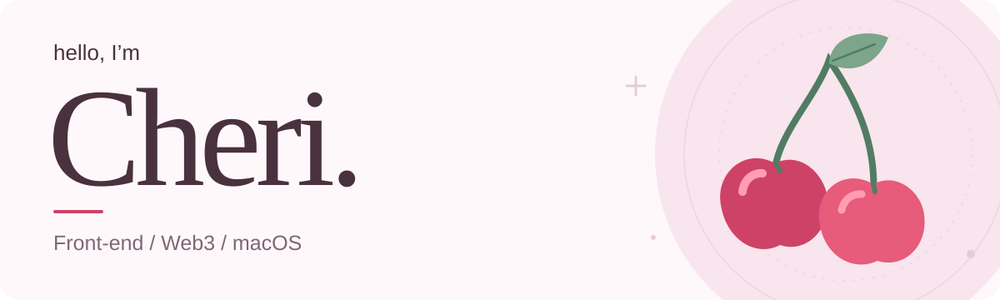

<picture>
  <source media="(prefers-color-scheme: dark)" srcset="./assets/cheri-dark.svg">
  <source media="(prefers-color-scheme: light)" srcset="./assets/cheri-light.svg">
  
</picture>

  把想法，做成用得上的作品。 
  喜欢前端与 Web3，也做一些让日常更顺手的小工具。

<code>Front-end</code> <code>Web3</code> <code>macOS</code>

  <a href="https://github.com/XuCheri?tab=repositories">所有项目</a>
  &nbsp; / &nbsp;
  <a href="https://github.com/XuCheri?tab=stars">开源收藏</a>

## 项目选集

<table>
  <tr>
    <td width="50%" valign="top">
      <h3>🎨 <a href="https://github.com/XuCheri/Artist-Scheduler">Artist Scheduler</a></h3>
      
给画师的稿件排期工具，用日历、时间轴和甘特图整理创作进度。

      
<code>JavaScript</code> <code>HTML</code> <code>CSS</code>

    </td>
    <td width="50%" valign="top">
      <h3>📱 <a href="https://github.com/XuCheri/andriodOnMac">AndroidOnMac</a></h3>
      
探索 Mac 与 Android 的双向投屏与控制，让设备协作更顺手。目前为预览版。

      
<code>Swift</code> <code>Kotlin</code>

    </td>
  </tr>
  <tr>
    <td width="50%" valign="top">
      <h3>🧹 <a href="https://github.com/XuCheri/macclean">MacClean</a></h3>
      
看清 Mac 的磁盘占用，整理应用残留与缓存。先预览，再移入废纸篓。

      
<code>Swift</code> <code>macOS</code>

    </td>
    <td width="50%" valign="top">
      <h3>🔗 <a href="https://github.com/XuCheri/web3_auction">Web3 Auction</a></h3>
      
一个 Web3 拍卖应用实验，连接竞价界面、订单服务与智能合约。

      
<code>Vue</code> <code>Solidity</code> <code>ethers.js</code>

    </td>
  </tr>
</table>

## 也在折腾

- **[Crypto Trading Dashboard](https://github.com/XuCheri/crypto-trading-dashboard)** — 用前端呈现加密市场行情与数据。
- **[LogTrace Panel](https://github.com/XuCheri/LogTrace-Panel)** — 以日志面板呈现的加密聊天浏览器扩展。

---

从一个小想法开始，慢慢把它做好。🍒

